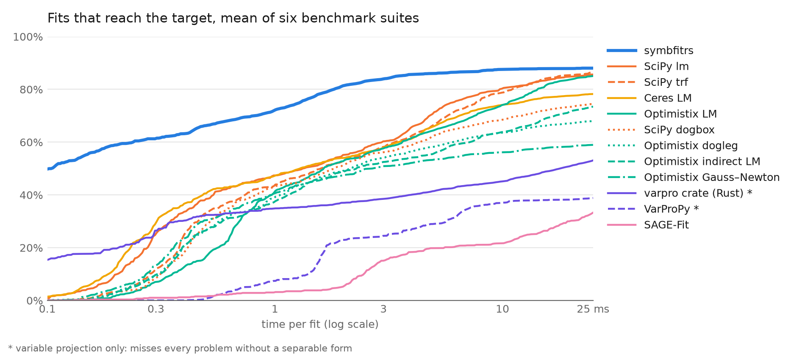

# symbfitrs

A fast CPU fitter for nonlinear equations, written in Rust, for symbolic regression. Not installable yet: see the [roadmap](docs/roadmap.md).

<picture>
  <source media="(prefers-color-scheme: dark)" srcset="docs/benchmark-dark.png">
  
</picture>

Six suites (NIST StRD, Moré–Garbow–Hillstrom, FitBenchmarking, SAGE-Fit, Stringer 2019, synthetic up to 99 parameters); one thread per fit; SciPy `least_squares` at its defaults; compile time not counted. SAGE-Fit data is Python code the benchmark executes, so fetch only data you trust. Needs [uv](https://docs.astral.sh/uv/) and [cargo](https://rustup.rs/).

```bash
uv sync && uv run python -m bench.fetch nist fitbenchmarking sagefit stringer2019  # 860 MB
for s in nist_strd mgh fitbenchmarking synthetic_scale sagefit_spb stringer2019_gratings; do
  uv run python -m bench run $s && uv run python -m bench run $s --fitter; done
uv run python -m bench.figure
```

MIT licence; downloaded benchmark data keeps its own.
