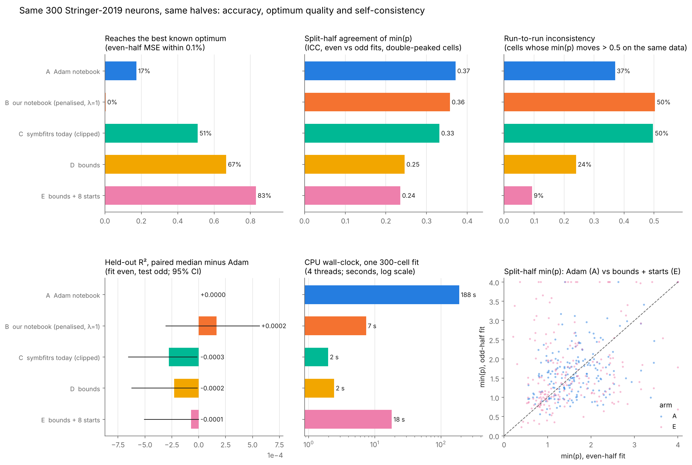

# Neuron tuning fits: Adam vs symbfitrs, self-consistency, and the exponent p

Branch `claude/focused-hopper-o1g2wl`. Every number below comes from the scripts and result files in `analysis/`, run on the public Stringer 2019 V1 drifting-gratings recording (`python -m bench.fetch stringer2019`). The users' own JR026 recording was not available. Their two notebooks are committed in `analysis/notebooks/`, and the scripts take the model, estimators and both fitting procedures from those notebooks, matched by content.

## Summary

- **R² gap.** The users' two notebooks fit **different recordings**, so their R² values cannot be compared. On the same data every method predicts held-out data equally well: paired R² differences are below 0.001.
- **Different curves, different p.**
  - The curves differ by less than one noise standard error, but the fitted exponent p differs a lot.
  - At 4 trials per bin the least-squares optimum is flat in p.
  - With the original cap of 4, p sits at that cap in about 45% of neurons. Adam's early stopping and our λ penalty hide this by pulling the fit toward the starting estimate.
- **Self-consistency.**
  - Bounds plus 8 starts reaches the best optimum in 83% of neurons, against Adam's 17%. Rerunning it on the same data moves min p by more than 0.5 in 9% of neurons, against 37% for Adam with a different validation split.
  - It takes 18 s for 300 neurons on a CPU, against 188 s for Adam.
- **Overfitting.**
  - The curves are not fitted to noise: they land about 30% closer to the true curve than the estimator.
  - The exponent p is fitted to noise: least squares recovers min p worse than the estimator alone.
- **Empirical Bayes.**
  - A weighted profile likelihood with a population prior learned from the data recovers min p best, with RMSE 0.32 against 0.56–0.69 for the other methods.
  - It is unbiased and needs no λ.
  - Its 95% intervals cover the truth about 88% of the time.
- **Single neurons vs the population.**
  - Per-neuron p is only weakly determined at this trial count.
  - The population distribution of p is well determined.
- **Library features**, each in its own PR into `dev`:
  1. active-set `bounds=`;
  2. multi-start through a 2-D `p0`;
  3. `Model.profile()`.

- **Removing the cap on p** makes least squares worse: p exceeds 10 in about 30% of neurons, split-half agreement collapses and held-out R² drops slightly. The cap of 4 was acting as a regulariser.

- **Empirical Bayes is robust to the cap.** Without it, the population median min p for double-peaked cells is 1.88 (95% CI 1.83–1.96), against 1.85 (1.81–1.91) with it. The scientific answer does not depend on the cap.

## 1. Why the notebooks' R² and curves differ

| | Adam notebook | Our notebook |
|---|---|---|
| Data file | `JR026/collated_exp04-27.npz` | `JR026/collated_exp04-01.npz` |
| Cells kept | 2,696 of 53,885 | 3,077 of 53,826 |
| Fit | Adam, lr 1e-3, early stopping: validation bins pick the step, then a refit on all bins | LM to convergence plus a penalty toward the estimator, λ = 1, chosen on test R² |
| Median test R², Gaussian / generalised Gaussian | 0.511 / 0.517 | 0.539 / 0.539 |

- The plain Gaussian has no exponent, yet it also differs by 0.028, so the R² gap comes from the recordings.
- Our λ was tuned on test R², so our number is also slightly optimistic.
- Section 2 compares the methods on identical data.

## 2. Same data, same question: self-consistency (`consistency.py`)

**Setup.**
- 300 random Stringer neurons that pass the notebooks' screens (signal fraction > 0.6, concentration > 0.3).
- Two pseudo-repeats of 4 trials per angle bin (214 bins).
- Each method is fitted to the even half, to the odd half, and to the even half 5 more times, each time with one of its arbitrary choices changed: Adam's validation-split seed, or a perturbed start or random restarts for the others.
- Each fit is scored on the notebook's model.

| Method | Reaches best optimum (MSE within 0.1%) | Held-out R² minus Adam (95% CI) | min p moves > 0.5 when refit with a changed start/split | Split-half ICC of min p | p at cap of 4 | CPU, 300 cells |
|---|---|---|---|---|---|---|
| A: Adam notebook | 17% | 0 | 37% | 0.37 | 18% | 188 s |
| B: our notebook (λ = 1) | 0% | +0.0002 (−0.0003, +0.0006) | 50% | 0.36 | 10% | 7 s |
| C: symbfitrs today (clipped) | 51% | −0.0003 (−0.0007, 0.0000) | 50% | 0.33 | 45% | 2 s |
| D: bounds | 67% | −0.0002 (−0.0006, 0.0000) | 24% | 0.25 | 47% | 2 s |
| E: bounds + 8 starts | 83% | −0.0001 (−0.0005, 0.0000) | 9% | 0.24 | 45% | 18 s |



What the table shows:
- Every method's curve is within 1 noise SE of Adam's in all 300 neurons; the median gap is under 0.1 SE.
- Even so, min p differs from Adam's by more than 0.5 in 11–33% of neurons.
- The population median of min p (reproducible cells) depends on the method: 1.17 (E) to 1.52 (A).
- At the true optimum, many fits pin p at the cap, some as flat-topped peaks (`consistency_examples.png`).
- Cross-validating λ over angle bins gives a flat curve that keeps drifting toward stronger shrinkage (λ = 10 still "wins"). λ is a prior choice, not a measured one.

## 3. Generalisation: are we fitting noise? (`explore.py`, 60 neurons)

Adam's held-out angles only choose when to stop; they add no data. This section compares methods on four measures:

- **Held-out R²:** the paired difference on the other repeat.
- **Held-out angles:** MSE on 20% of the angles left out of the fit.
- **Effective parameters:** from the train/test gap.
- **Distance to the true curve and p recovery:** both on synthetic halves with a known truth (p drawn uniformly from 0.7–3, noise matched to each neuron).

| Method | R² vs E (real) | Held-out-angle MSE vs estimator | Effective parameters (synthetic) | Distance to true curve (noise SE) | min p RMSE (synthetic) | p at cap (real) |
|---|---|---|---|---|---|---|
| Estimator only | −0.015 | 1.00 | about 0 | 0.39 | 0.56 | 8% |
| Adam, early stop | +0.003 | 0.92 | 3.0 | 0.25 | 0.62 | 18% |
| Adam, no stop | −0.001 | 0.93 | 3.5 | 0.27 | 0.65 | 45% |
| E: bounds + 8 starts | 0 | 0.91 | 4.4 | 0.27 | 0.72 | 42% |

- **Curves:** fitting brings the curve about 30% closer to the true curve than the estimator does, with fewer effective parameters than the model's 10.
- **Exponents:** least squares pins p at the cap in a third of synthetic cells, although the true p never exceeds 3. It recovers min p worse than the estimator alone.
- **Early stopping** is a weak regulariser: +0.004 R², a slightly better curve, and fewer fits at the cap. It does not help on held-out angles. Changing only the random validation split moves p by more than 0.5 in 20% of cells.
- **Minimum width:** the minimum-width bound acts as a hidden regulariser. Allowing peaks two bins wide lets fits chase single noisy bins at the same training loss.

## 4. The exponent p: empirical Bayes instead of λ (`profile_eb.py`, `calibrate_eb.py`)

**Method:**

1. For each cell, pin (p1, p2) on a grid by bounds with lo = hi, and fit everything else with residuals weighted by each bin's noise.
2. Fit one population prior for p, a normal in log p, by maximising the marginal likelihood over all cells. Its two parameters are learned from the data.
3. Each cell's p is its posterior. A flat likelihood leans on the population; a sharp one keeps its own value.

**Synthetic recovery of min p** (60 neurons, known truth):

| Method | RMSE | Bias | Split-half ICC |
|---|---|---|---|
| Least squares | 0.69 | −0.11 | 0.29 |
| Adam, early stop | 0.62 | −0.13 | — |
| Estimator only | 0.56 | −0.18 | — |
| Empirical Bayes, unweighted, spiky nonparametric prior | 0.43 | −0.01 | 0.69 |
| **Empirical Bayes, weighted, log-normal prior** | **0.32** | **+0.03** | **0.85** |

**Calibration.**
- Nominal 90% intervals cover 82% of synthetic cells, and 95% intervals cover 88%. Report the 95% interval as a roughly 90% interval.
- Most of the original under-coverage (72%) came from the spiky nonparametric prior, not from the grid.
- The remaining gap matches the true-prior oracle (83%), so it comes from profiling out the 8 nuisance parameters rather than integrating over them.
- These did not help: a Laplace correction, refitting the profile from neighbouring grid points, separate priors per peak, and tempering the likelihood.
- On real data the noise is rescaled to each cell's own residuals, because a mean–variance noise model overestimated it about 1.6×. This rescaling changes nothing on synthetic data, where the noise is known.

**Real data, 300 neurons (cap 4):**
- Each peak's p has population median 2.38; 80% of neurons fall between 1.37 and 4.16.
- The 199 double-peaked cells have median posterior min p 1.85 (95% CI 1.81–1.91).
- Per neuron, the median 95% interval is 1.7 wide.
- The two halves' intervals overlap in every neuron (ICC 0.47).

## 5. Capped vs uncapped p (`P_CAP=inf`)

The notebooks clip p to [0.1, 4]. Every arm was rerun with no upper limit; the lower limit and the width limits stay (`analysis/consistency_pinf/`, `consistency_pinf.png`).

| Method | Any p > 4 | Any p > 10 | Split-half ICC of min p (capped → uncapped) | Reproducible cells (capped → uncapped) | Held-out R² minus Adam (95% CI) | Reaches best optimum |
|---|---|---|---|---|---|---|
| A: Adam notebook | 18% | 3% | 0.37 → 0.39 | 41 → 37 | 0 | 14% |
| B: our notebook (λ = 1) | 10% | 2% | 0.36 → 0.36 | 74 → 74 | +0.0003 (−0.0002, +0.0009) | 0% |
| C: symbfitrs today (clipped) | 40% | 21% | 0.33 → 0.33 | 41 → 16 | −0.0004 (−0.0013, −0.0001) | 49% |
| D: bounds | 49% | 29% | 0.25 → 0.07 | 38 → 17 | −0.0005 (−0.0011, −0.0001) | 61% |
| E: bounds + 8 starts | 49% | 31% | 0.24 → 0.01 | 40 → 18 | −0.0005 (−0.0012, 0.0000) | 81% |

- **Least squares:** without the cap, p runs away; it exceeds 10 in 21–31% of neurons, as flat-topped or box-shaped peaks.
  - Split-half agreement of min p collapses for the true-optimum fits (E: 0.24 → 0.01).
  - Held-out R² gets slightly worse, so the extra freedom fits noise.
- **Adam and our penalised fit barely change.** Early stopping and the penalty keep p near the estimator, so the cap rarely bound them.
- **The cap was acting as a regulariser.** The data do not identify p at its upper end. A per-neuron least-squares p is therefore only as meaningful as the cap chosen.
- **Single-start uncapped fits can be worse than capped ones.** On one neuron, D settled at p1 = 5.3 with a higher loss than the capped optimum. Several starts mostly fix this: E reaches the best optimum in 81% of neurons.

**Synthetic data, no cap (true p in 0.7–3), 60 neurons:**

| Method | min p RMSE | Dominant-peak p RMSE | p > 4 in any peak |
|---|---|---|---|
| Estimator only | 0.56 | 0.45 | 18% |
| Adam, early stop | 0.62 | 1.43 | 25% |
| E: bounds + 8 starts | 0.66 | 5.79 | 0% at a cap (none set); runaway values instead |
| Empirical Bayes, weighted, log-normal prior | 0.37 | — | — |

- Uncapped least squares sends the dominant peak's p far above the truth: RMSE 5.8, against 0.70 with the cap.
- min p still looks reasonable, because the weaker peak's p sets the minimum.

**Empirical Bayes without the cap** uses a p grid of 0.4–16:
- **Synthetic data:** RMSE 0.37 (0.32 with the cap) and bias +0.02. Nominal 90% / 95% intervals cover 82% / 87%, the same as capped. 92% of cells agree between halves within 0.5.
  - Its split-half ICC is −0.05, against 0.85 capped. A variance-based ICC is dominated by a few cells with extreme posteriors once p may reach 16, so the |diff| share is the more robust measure here.
- **Real data, 300 neurons:**
  - Each peak's population median p is 2.31 (80% of neurons in 1.23–4.34), against 2.38 with the cap.
  - Double-peaked cells (199): median posterior min p is **1.88 (95% CI 1.83–1.96)**, against 1.85 (1.81–1.91) with the cap.
  - Per neuron: median 95% width 1.86, split-half ICC 0.44, and the halves' intervals overlap in 99% of neurons.

So the cap changes least-squares answers a lot and empirical-Bayes answers hardly at all. Per-neuron least-squares p values are not meaningful without a cap, and with one they mostly reflect the cap. The population distribution from empirical Bayes is stable either way.

### Checks on the empirical-Bayes layer (`eb_checks.py`, no new fits)

- **Empirical Bayes as arm G of the 300-neuron table.** Its split-half agreement on real data is the best of any method. Run-to-run inconsistency is 0, because it is deterministic given the data.

| | Split-half ICC of min p, capped | Same, uncapped | Within 0.5 between halves, capped / uncapped |
|---|---|---|---|
| A: Adam notebook | 0.37 | 0.39 | — |
| E: bounds + 8 starts | 0.24 | 0.01 | — |
| **G: empirical Bayes** | **0.47** | **0.44** | 78% / 68% |

- **Prior family.** Log-normal, gamma, a two-component log-normal mixture and a smoothed nonparametric prior give the same synthetic recovery (capped RMSE 0.32–0.33). The real-data median min p of double-peaked cells moves within about 0.1:
  - 1.74–1.85 capped; the smoothed nonparametric prior is the low end, and its CI does not overlap the log-normal's;
  - 1.84–1.91 uncapped, where all CIs overlap.

  The mixture fits the real data best by marginal likelihood (−1141 vs −1168 capped), a hint that the population of p is heavier-tailed or bimodal; check this on JR026. Uncapped, it recovers p worse on synthetic data (RMSE 0.57), so log-normal stays the default.
- **The uncapped synthetic ICC of −0.05 is one cell.** On cell 29 the odd half's posterior mean is 14.6, against 0.57 for the even half and a truth of 0.70. Dropping the 3 largest gaps gives 0.83; Spearman is 0.71, and 92% of cells agree within 0.5.

## 6. Library features (PRs into `dev`)

- [wd7512/symbfitrs#21](https://github.com/wd7512/symbfitrs/pull/21): active-set `bounds=` on `Model.fit` and `Pool.fit_many`.
- [wd7512/symbfitrs#22](https://github.com/wd7512/symbfitrs/pull/22): multi-start through a 2-D `p0`, with `start_losses` and `start_params`.
- [wd7512/symbfitrs#23](https://github.com/wd7512/symbfitrs/pull/23): `Model.profile()`.

Each PR branches from `dev` independently, and #21 and #22 need a small rebase against each other.

The gate could not run, because its tier files need full local benchmark runs. Instead, `default_path_regression.py` compared each PR with `dev` on 500 fits:
- all 480 non-deadline fits are bit-identical to `dev`;
- wall time is within 0.3% (results in `pr_regression/`).

- **Bounds.** A parameter on a bound is dropped from the LM step while its gradient points out of the box, and is released when the gradient turns inward. Each trial point is clipped into the box, and the predicted reduction is recomputed for the clipped step. With lo = hi it fixes a parameter. On the clipped notebook model, bounds that replace the clips raise the share of neurons reaching the best optimum from 51–57% to 67–76%.
- **Multi-start.** A 2-D `p0` gives one start per row, within one job's budget. `start_losses` and `start_params` show per cell whether the optimum is unique.
- **`Model.profile()`.** Fits a grid of fixed parameter values through one compiled model, with the fixed parameters passed as data. This is the building block for the empirical-Bayes method above.
- The per-step cap from the earlier prototype was dropped: it is scale-sensitive and adds little once bounds replace the clips.

## 7. Recommendations

1. **Fit with bounds and several starts**, not with clips inside the model or early stopping. R² is the same, the answer is reproducible, and it takes seconds on a CPU.
2. **Report p as an empirical-Bayes posterior** with its 95% interval, together with the population distribution. This replaces the ±0.5 reproducibility filter. `recipe_tuning_fit.py` is a drop-in `fit()` for the notebooks.
3. **Do not rely on per-neuron least-squares p.** With the cap it mostly reflects the cap; without it, p runs away. If a cap is kept, choose it and the minimum width deliberately and report them. The empirical-Bayes population result barely changes with or without the cap (section 5).
4. **Run the comparison on JR026 itself.** The notebooks' data have 256 bins and one repeat per half, so the per-neuron intervals will differ.

## 8. Caveats

- Everything comes from one recording (Stringer), with my own binning (214 bins, two pseudo-repeats of 4 trials), not JR026.
- The synthetic truth is built from each neuron's arm-E fit with p redrawn, so it inherits that fit's widths, including some at their bounds.
- Adam ran on a 4-core CPU; the notebooks ran it on an Apple GPU, which was not measured.
- "Best optimum" means the best any method or rerun found for that neuron.
- The empirical-Bayes intervals undercover slightly (section 4).

## 9. Reproduce

```bash
git switch claude/focused-hopper-o1g2wl
```

```bash
uv sync && uv pip install -e . && uv pip install torch --index-url https://download.pytorch.org/whl/cpu
```

```bash
uv run python -m bench.fetch stringer2019
```

```bash
PYTHONPATH=analysis uv run python analysis/consistency.py C D E B A F boot_D
```

```bash
PYTHONPATH=analysis uv run python analysis/summarize_consistency.py
```

```bash
PYTHONPATH=analysis uv run python analysis/explore.py
```

```bash
PYTHONPATH=analysis uv run python analysis/profile_eb.py
```

```bash
PYTHONPATH=analysis uv run python analysis/calibrate_eb.py 1 2 4 6 9 300
```

Add `P_CAP=inf` in front of any of these to remove the exponent cap; results then go to the `*_pinf` files and directories.
